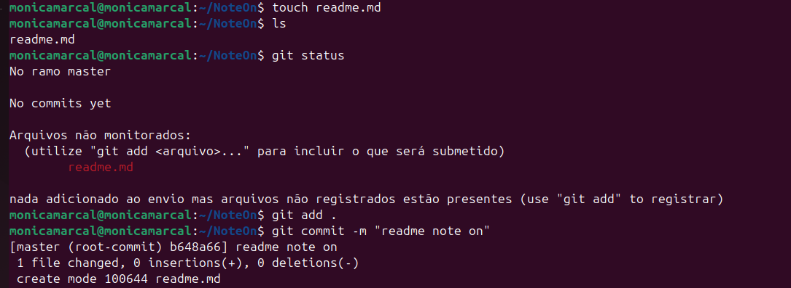
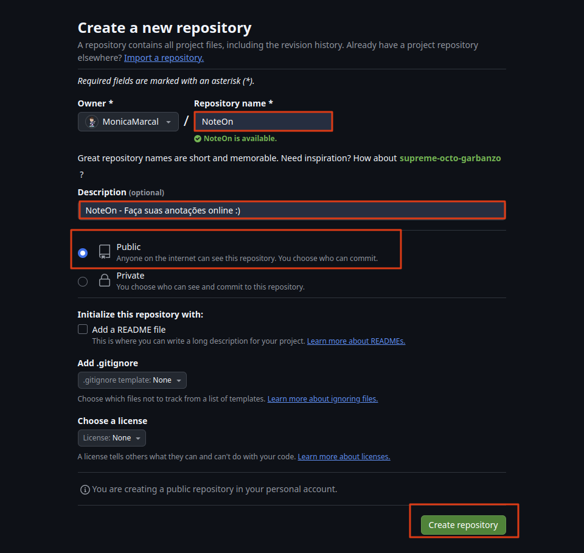
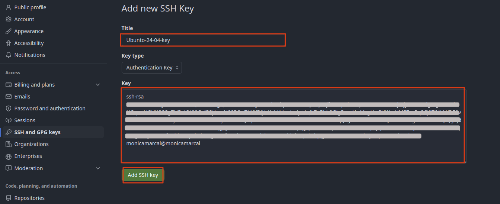
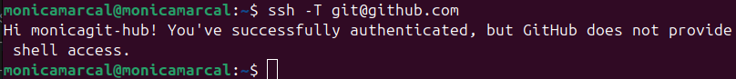
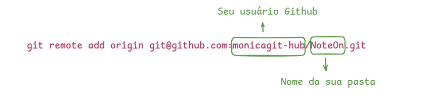
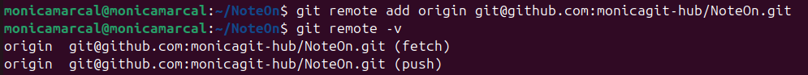

# Instalação do Git e Conexão com GitHub via SSH

Guia passo a passo para instalar o Git, configurar sua identidade e conectar ao GitHub usando chave SSH.

---

## Parte 1 — Instalar e configurar o Git

0. **Abra o terminal**
 

1. Atualize o sistema:

    `sudo apt update && sudo apt upgrade`

2. Instale o Git:

    `sudo apt install git`

3. Confirme a versão instalada:

    `git --version`

4. Configure sua identidade e preferências globais:

    `git config --global user.name "seu-usuario-github"`

    `git config --global user.email "seu@email.com"`

    `git config --global init.defaultBranch main`

5. Confirme as configurações:

    `git config --list`

---

## Parte 2 — Criar um repositório local

6. Crie uma pasta e inicialize um repositório Git:

    `mkdir NomeDoSeuProjeto` &nbsp;&nbsp;(cria a pasta do projeto)

    `cd NomeDoSeuProjeto` &nbsp;&nbsp;(entra na pasta)

    `git init` &nbsp;&nbsp;(inicializa o repositório Git)

7. Adicione um arquivo ao projeto:

    `touch README.md` &nbsp;&nbsp;(cria um arquivo README)

    `ls` &nbsp;&nbsp;(lista o conteúdo da pasta)

    `git status` &nbsp;&nbsp;(verifica o status dos arquivos)

8. Faça o primeiro commit:

    `git add .`

    `git commit -m "feat: primeiro commit"`

     
 

---

## Parte 3 — Criar o repositório no GitHub

9. **Acesse [github.com](https://github.com), faça login e clique em `New` para criar um novo repositório.**
Siga as instruções conforme a imagem abaixo:
 

     
 

---

## Parte 4 — Gerar e configurar chave SSH

10. Gere uma chave SSH do tipo **Ed25519** (padrão recomendado desde 2022):

    `ssh-keygen -t ed25519 -C "seu@email.com"`

    - Quando perguntar onde salvar, pressione **Enter** para usar o caminho padrão (`~/.ssh/id_ed25519`)
    - Quando perguntar a senha (passphrase), pressione **Enter** para deixar sem senha, ou digite uma senha se preferir

11. Copie o conteúdo da sua chave pública:

    `cat ~/.ssh/id_ed25519.pub`

12. Volte ao GitHub e adicione a chave em:

    `Settings → SSH and GPG keys → New SSH key`

    Cole a chave no campo **Key**, conforme a imagem abaixo:

     

 

---

## Parte 4.1 — Se você deu um nome personalizado à chave (opcional)

Se ao executar o passo 10 você digitou um nome (ex: `pink`) em vez de pressionar Enter, o arquivo foi salvo com esse nome na pasta atual. Siga os passos abaixo:

1. Exiba o conteúdo da chave pública gerada:

    `cat pink.pub`

     

2. Copie a chave e adicione no GitHub (igual ao passo 12 acima).

3. Mova os arquivos para o local padrão do SSH:

    `mkdir -p ~/.ssh`

    `mv pink ~/.ssh/id_ed25519`

    `mv pink.pub ~/.ssh/id_ed25519.pub`

    `chmod 600 ~/.ssh/id_ed25519`

    `chmod 644 ~/.ssh/id_ed25519.pub`

4. Se estiver usando o SSH Agent, carregue a chave:

    `eval "$(ssh-agent -s)"`

    `ssh-add ~/.ssh/id_ed25519`

5. Teste a conexão com o GitHub:

    `ssh -T git@github.com`

     

 

---

## Parte 5 — Conectar o repositório local ao GitHub

13. Adicione o repositório remoto (substitua `seu-usuario` e `seu-repositorio`):

    `git remote add origin git@github.com:seu-usuario/seu-repositorio.git`

     

14. Confirme o remoto configurado:

    `git remote -v`

     

15. Verifique o nome da sua branch:

    `git branch`

16. Envie as alterações para o GitHub:

    `git push -u origin main`

     

 

17. **Entre na sua conta do GitHub — arquivo enviado com sucesso!**

     
